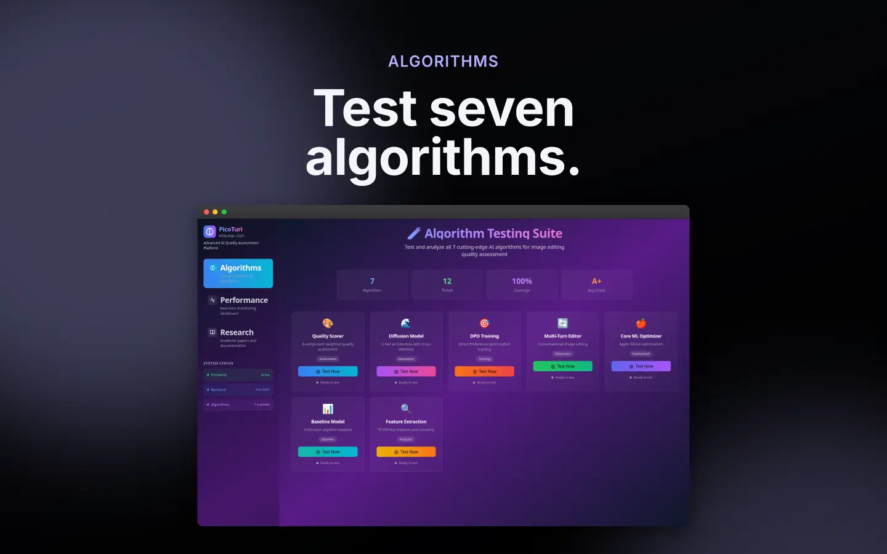
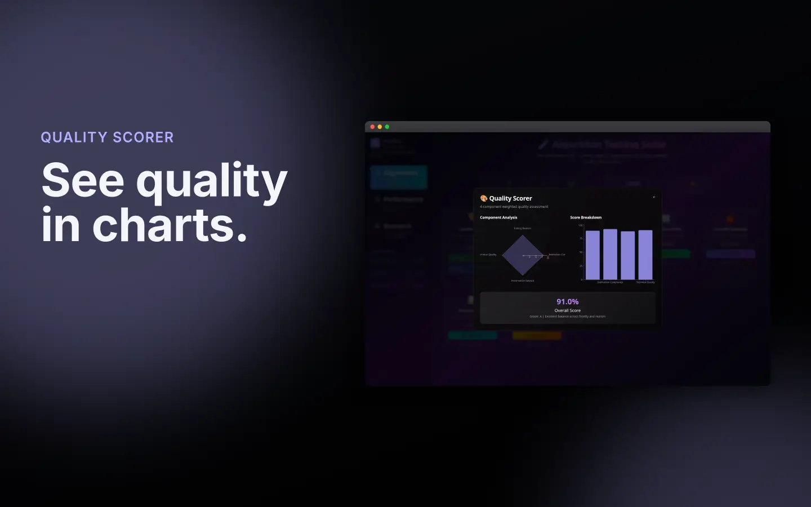
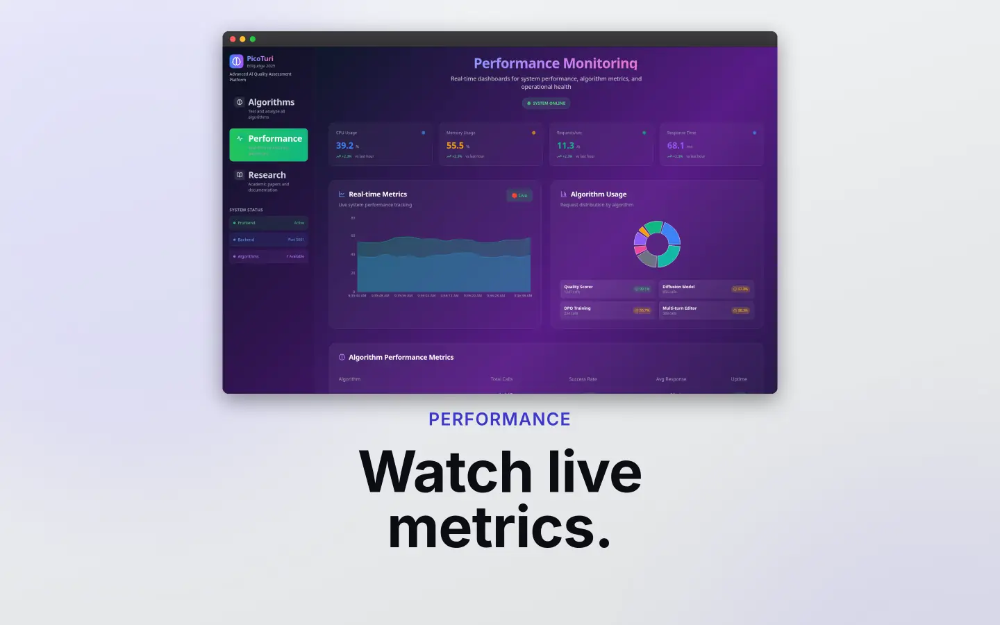
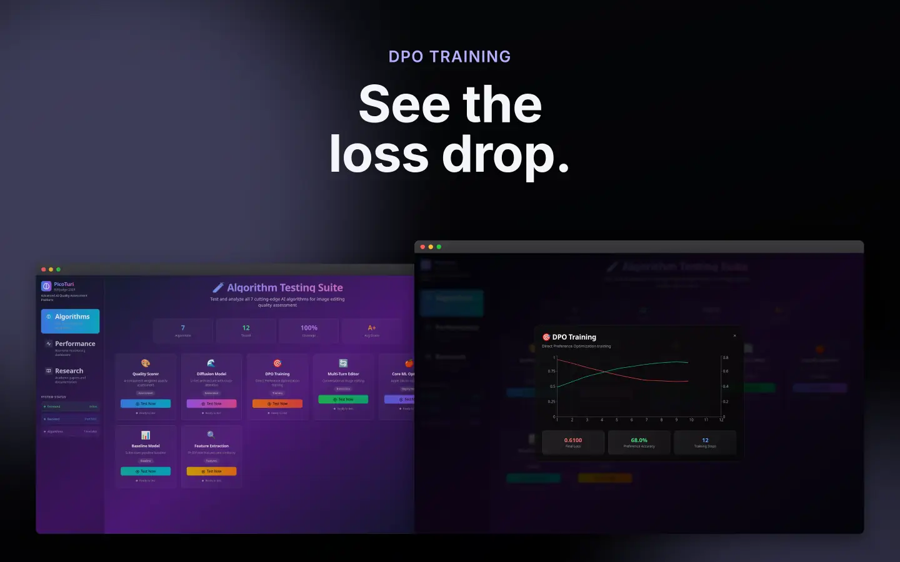
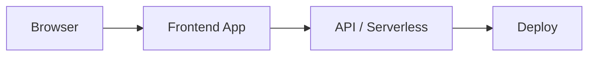

# 🤖 PicoTuri - AI Algorithm Quality Assessment Platform

[](https://mangeshraut712.github.io/PicoTuri-EditJudge/)
[](https://opensource.org/licenses/MIT)
[](https://reactjs.org/)
[](https://flask.palletsprojects.com/)
[](https://vitejs.dev/)

> **Professional AI Algorithm Testing & Quality Assessment Platform** - Real-time interactive visualizations for machine learning model evaluation and benchmarking.

## ✨ Overview

PicoTuri is a comprehensive full-stack platform for testing, benchmarking, and visualizing AI/ML algorithms. Built for researchers, data scientists, and machine learning engineers who need to evaluate and compare different ML models across multiple performance metrics.

### 🎯 Key Highlights

- **7 Complete Algorithm Implementations** with individual API endpoints
- **11 Interactive Chart Types** for rich data visualization
- **Real-time Performance Monitoring** with live metrics
- **Production-Ready Architecture** with automated deployment
- **Comprehensive Testing Suite** with Jest & mock data
- **Modern Glass Morphism UI** with responsive design

### 🚀 Live Demo

- **Frontend:** [View Live Application](https://mangeshraut712.github.io/PicoTuri-EditJudge/)
- **Backend API:** run locally (`python api/index.py`) — GitHub Pages hosts the static frontend only
- **Repository:** [GitHub](https://github.com/mangeshraut712/PicoTuri-EditJudge)

## Screenshots

Framed captures of the live app (current UI).

<div align="center">









</div>

## 🎯 Algorithm Testing Suite

Our platform includes comprehensive testing for 7 cutting-edge AI/ML algorithms:

### 1. 📊 Quality Scorer
**Purpose:** Multi-dimensional quality assessment for text generation models

**Features:**
- 4-component radar visualization (Coherence, Fluency, Relevance, Creativity)
- Interactive hover tooltips with detailed metrics
- Performance benchmarking across quality dimensions

### 2. 🎨 Diffusion Model
**Purpose:** U-Net architecture analysis for image generation

**Features:**
- Denoising process visualization
- Layer-by-layer attention mechanism display
- Generation quality metrics across time steps

### 3. 💬 Multi-Turn Editor
**Purpose:** Conversational AI session analysis

**Features:**
- Session flow visualization with turn-by-turn analysis
- Context retention tracking across conversations
- Response quality metrics over conversation length

### 4. 🔄 DPO Training
**Purpose:** Direct Preference Optimization loss convergence

**Features:**
- Training loss curves with convergence visualization
- Preference reward modeling metrics
- Train/validation accuracy tracking

### 5. 🚀 Core ML Optimizer
**Purpose:** Apple Silicon performance optimization

**Features:**
- Neural Engine utilization metrics
- Memory bandwidth optimization tracking
- Performance boost levels across different models

### 6. 📈 Baseline Model
**Purpose:** Traditional ML algorithm comparison

**Features:**
- Accuracy/F1-score bars across multiple models
- Feature importance radar charts
- Training time vs accuracy trade-off visualization

### 7. 🔍 Feature Extraction
**Purpose:** Text feature similarity analysis

**Features:**
- TF-IDF vector similarity heatmaps
- Semantic clustering visualizations
- Feature importance ranking with bar charts

## 🛠️ Technology Stack

### Frontend
- **React 18** - Modern component-based UI
- **Vite 7.3** - Build tool with HMR
- **Tailwind CSS 3** - Utility-first styling framework
- **Recharts 2.15** - Interactive charting library
- **Lucide React** - Icon system
- **Axios 1.20** - HTTP client

### Backend
- **Python 3.10+** - Core programming language
- **Flask 3.1** - Lightweight REST API framework
- **Flask-CORS** - Cross-origin resource sharing
- **NumPy/Pandas** - Scientific computing and data manipulation
- **Scikit-learn** - Machine learning algorithms

### Development & Deployment
- **Jest 30** - JavaScript testing framework
- **Babel 7** - JavaScript compiler
- **ESLint** - Code linting and formatting
- **Pyright 1.1** - Python type checking
- **GitHub Pages** - Static frontend hosting via GitHub Actions
- **Git** - Version control with branching strategy

### Testing & Quality
- **Jest Testing Framework** - Component and integration tests
- **Mock Data Fallbacks** - Reliable offline functionality
- **Static Type Checking** - TypeScript-style Python hints
- **Code Analysis** - Flake8 and ESLint configurations

## 🚀 Quick Start

### Prerequisites
- Node.js 22.12+ and npm
- Python 3.10+ and pip
- Git for version control

### Clone the repository
```bash
# Clone repository
git clone https://github.com/mangeshraut712/PicoTuri-EditJudge.git
cd PicoTuri-EditJudge

```

### Manual Setup

#### Frontend Setup
```bash
# Install dependencies
npm ci

# Start development server
npm run dev
# 🟢 Frontend available at http://localhost:3000
```

#### Backend Setup
```bash
# From the repository root, install the lightweight demo API dependencies
python3 -m venv .venv
source .venv/bin/activate
python -m pip install -r api/requirements.txt

# Start Flask server
python api/index.py
# 🟢 Backend API available at http://localhost:5001
```

## 🔧 Development

### Available Scripts

```bash
# Frontend
npm run dev          # Start Vite dev server
npm run build        # Production build
npm run preview      # Preview production build
npm run test         # Run Jest tests
npm run lint         # ESLint code analysis

# Backend
cd api && python index.py  # Start Flask API

# Backend regression tests (after activating .venv)
python -m unittest discover -s tests -v
```

### Project Structure

```
PicoTuri-EditJudge/
├── 📁 api/                 # Flask REST API backend
│   ├── index.py           # Main API server with endpoints
│   └── requirements.txt   # Python dependencies
│
├── 📁 src/                 # React frontend application
│   ├── components/        # Reusable UI components
│   │   ├── algorithms/    # Chart visualization components
│   │   └── layout/        # Navigation and layout
│   ├── pages/            # Page components
│   ├── utils/            # API utilities and helpers
│   └── App.jsx           # Main React application
│
├── 📁 __mocks__/          # Jest test mocks
├── 📁 .vscode/           # Development environment settings
├── 📄 package.json       # Node.js dependencies and scripts
├── 📄 vite.config.js     # Vite build configuration
├── 📄 vercel.json        # Vercel deployment configuration
├── 📄 jest.config.cjs    # Testing configuration
└── 📄 README.md          # This documentation
```

## 📡 API Documentation

Algorithm endpoints are POST requests and return demonstration JSON. Every payload includes `data_source: "demo"`.

### Core Endpoints

| Resource | Endpoint | Method | Description |
|----------|----------|--------|-------------|
| Health | `/api/health` | GET | Service status |
| Stats | `/api/stats` | GET | Algorithm count; unmeasured stats are null |
| Performance | `/api/performance/status` | GET | Simulated system samples |
| Quality Scorer | `/api/test/quality-scorer` | POST | Sample quality metrics |
| Diffusion Model | `/api/test/diffusion-model` | POST | Sample diffusion metrics |
| Multi-Turn Editor | `/api/test/multi-turn` | POST | Sample editor metrics |
| DPO Training | `/api/test/dpo-training` | POST | Sample training metrics |
| Core ML Optimizer | `/api/test/coreml` | POST | Sample optimizer metrics |
| Baseline Model | `/api/test/baseline` | POST | Sample classifier metrics |
| Feature Extraction | `/api/test/features` | POST | Sample similarity metrics |

### Example

```bash
curl -s http://127.0.0.1:5001/api/health
curl -s -X POST http://127.0.0.1:5001/api/test/quality-scorer
```

## 🧪 Testing

### Frontend Testing
```bash
# Run all tests
npm test

# Watch mode for development
npm run test:watch

# Generate coverage report
npm run test:coverage
```

### Test Structure
```
src/__tests__/          # Navigation, API client, polling, chart, and page regressions
tests/test_api.py       # Demo contracts, CORS, HTTP errors, and server defaults
__mocks__/
├── fileMock.js         # Static file mocks
└── ...                 # Additional mocks

# Test commands include:
# - Component rendering tests
# - API integration tests
# - Chart visualization tests
# - User interaction tests
```

## 🚀 Deployment

### GitHub Pages (Recommended)
The Vite frontend deploys automatically from `main` via GitHub Actions (`npm ci && npm run build`, then `dist/` to Pages).

Live site: https://mangeshraut712.github.io/PicoTuri-EditJudge/

The Python API is not hosted on Pages. For a deployed frontend, set
`VITE_API_BASE_URL=https://your-api.example.com` when building and allow the frontend
origin with `CORS_ORIGINS=https://mangeshraut712.github.io` on the API server.
With no API origin configured, requests use same-origin `/api` routes. During local
development Vite proxies those routes to `http://127.0.0.1:5001`; production hosting
must provide an API or reverse proxy at `/api`, or set the build-time API origin.

The included API returns demonstration algorithm results and simulated performance
metrics, identified by `data_source: "demo"`. These are labeled in the dashboard.
Unavailable performance data stays unavailable; the history includes only successful
API samples. Offline algorithm examples are labeled as demo results and do not count
as completed tests.

### Docker Deployment
```dockerfile
# Example only. The frontend build needs the dev dependencies (Vite).
FROM node:22-alpine AS frontend
WORKDIR /app
COPY package*.json ./
RUN npm ci
COPY . .
RUN npm run build

FROM python:3.12-slim AS backend
WORKDIR /app
COPY api/requirements.txt .
RUN pip install --no-cache-dir -r requirements.txt
COPY api/ .

FROM nginx:alpine AS production
COPY --from=frontend /app/dist /usr/share/nginx/html
COPY --from=backend /app /app/api
```

### Manual Deployment
- Build frontend: `npm run build`
- Serve static files from `dist/`
- Run `python api/index.py` or deploy to cloud
- Configure nginx/reverse proxy for API calls

## 🔧 Configuration

### Environment Variables
```bash
# Backend shell environment (defaults shown)
export HOST=127.0.0.1
export PORT=5001
export CORS_ORIGINS=http://localhost:3000,http://127.0.0.1:3000
python api/index.py

# Frontend build environment (omit for same-origin /api)
VITE_API_BASE_URL=https://your-api.example.com npm run build
```

`VITE_API_BASE_URL` is a public API origin without the `/api` suffix and is embedded
at build time. It can also be set in `.env.local` before running Vite. CORS only
allows the configured, comma-separated origins on `/api/*`, with GET, POST, OPTIONS
and the Content-Type request header; credentials are disabled. The development
server binds to loopback unless `HOST` is explicitly changed.

### VSCode Settings
Pre-configured development environment:
- Python type checking with Pyright
- JavaScript linting with ESLint
- Vite debugging support
- Format on save enabled

## 🤝 Contributing

### Development Guidelines
1. **Branch Strategy:** `feature/` for new features, `fix/` for bug fixes
2. **Code Style:** ESLint for JS, flake8 for Python
3. **Testing:** Write tests for new features
4. **PR Review:** Required for all changes

### Algorithm Implementation
To add a new algorithm:
1. Implement backend logic in `api/index.py`
2. Add visualization component in `src/components/algorithms/`
3. Create API endpoint with proper data structure
4. Add routing and navigation
5. Write comprehensive tests

## 📊 Performance Monitoring

The performance page polls `GET /api/performance/status` and plots only successful samples. The included API marks those samples with `data_source: "demo"`. Responses send `Cache-Control: no-store` so browsers do not reuse a simulated reading.

## 🐛 Troubleshooting

### Common Issues

**Frontend Not Loading:**
```bash
# Clear cache and reinstall
rm -rf node_modules dist
npm install
npm run dev
```

**API Connection Issues:**
```bash
# Check if backend is running
curl -s http://127.0.0.1:5001/api/health
```

**Build Failures:**
```bash
# Clear npm cache
npm cache clean --force
rm -rf node_modules package-lock.json
npm install
```

## 📄 License

This project is licensed under the MIT License - see the [LICENSE](LICENSE) file for details.

## 🙏 Acknowledgments

- **React Ecosystem** - For the incredible development experience
- **Chart Libraries** - Special thanks to Recharts for visualization capabilities
- **Flask Community** - For maintaining the lightweight Python web framework
- **Open Source Contributors** - For libraries and tools that made this possible

## 🎯 Roadmap

### Phase 1 (Current)
- Demonstration results for 7 algorithms, labeled in the UI
- Charts that plot reported metrics only
- GitHub Pages frontend and a local Flask API

### Phase 2 (Next) 🔄
- [ ] WebSocket real-time updates
- [ ] Algorithm comparison tool
- [ ] Custom metric configurations
- [ ] Advanced filtering and search
- [ ] User session management

### Phase 3 (Future) 🚀
- [ ] ML model upload and testing
- [ ] Automated benchmarking system
- [ ] CI/CD pipeline integration
- [ ] Multi-cloud deployment support
- [ ] API rate limiting and authentication

---

<div align="center">

**Made with ❤️ for the AI/ML community**

[🚀 Live Demo](https://mangeshraut712.github.io/PicoTuri-EditJudge/) • [📖 Documentation](README.md) • [🐛 Issues](https://github.com/mangeshraut712/PicoTuri-EditJudge/issues) • [💬 Discussions](https://github.com/mangeshraut712/PicoTuri-EditJudge/discussions)

</div>

---

<!-- codex:project-diagram:start -->

## Project Diagram



_High-level flow of the deployed web experience and supporting services._

<!-- codex:project-diagram:end -->
